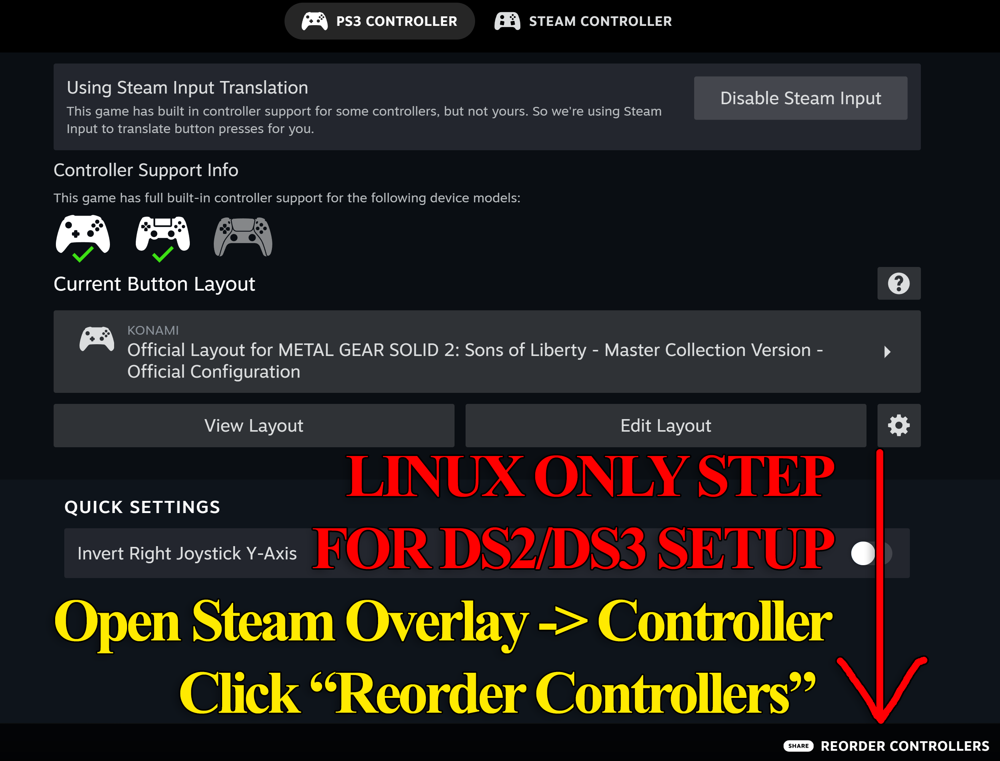
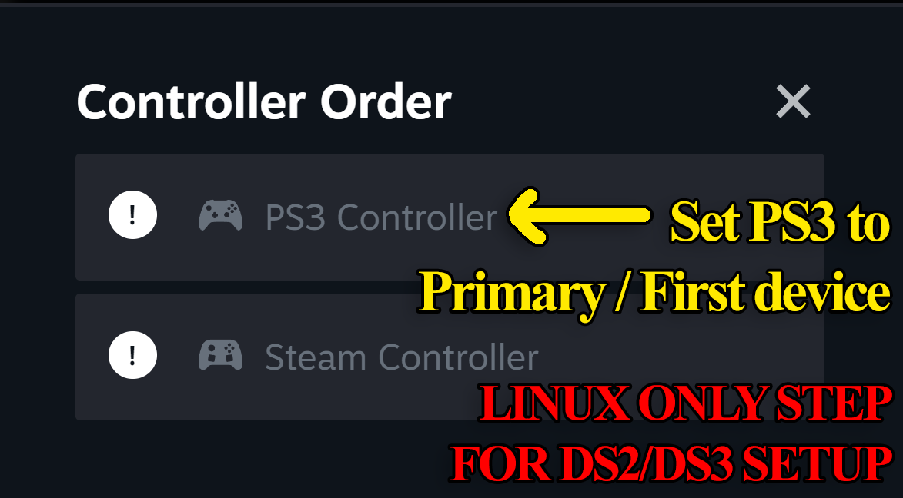
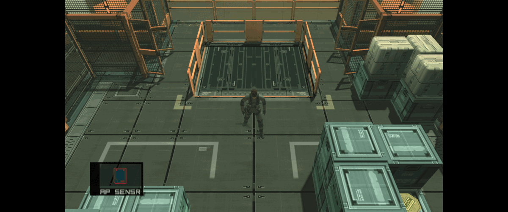
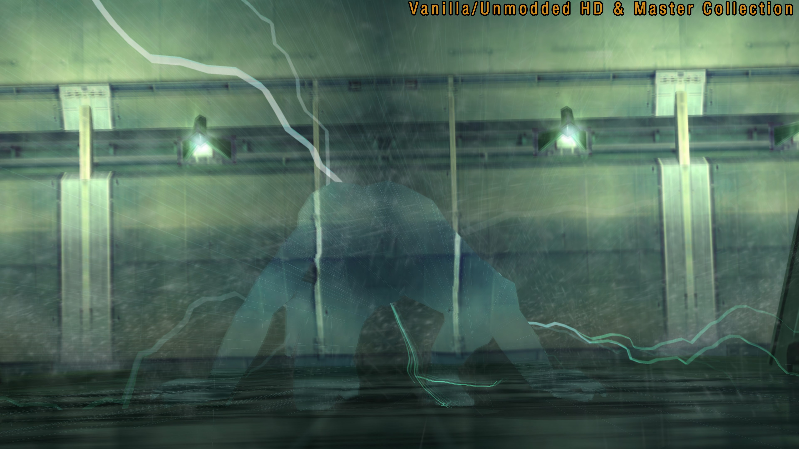
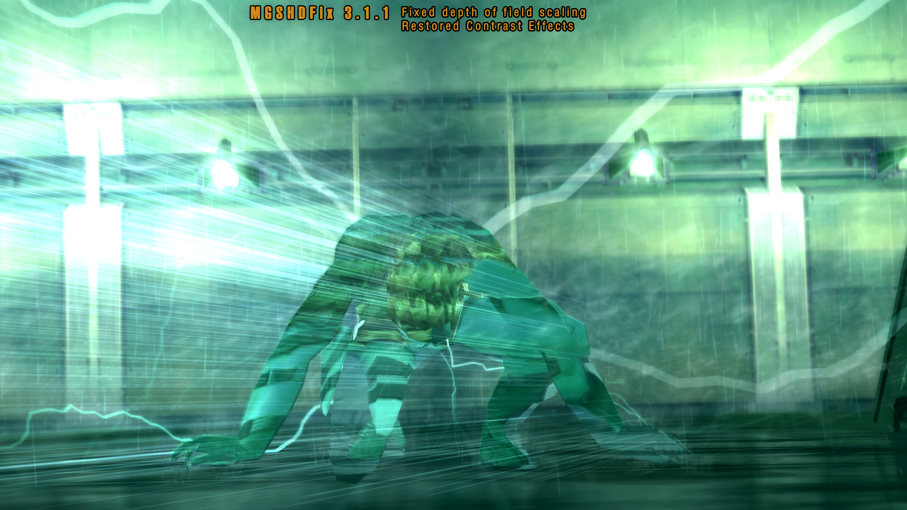

# MGSHDFix: Restoring Shadows and Stability for Metal Gear Solid 🎮

### ⌨️ PowerShell Command Button

  

---

This is the patch that drags the Metal Gear Solid Master Collection's PC ports back toward the PS2 originals they were meant to honor. Broken visual effects are restored, vanilla crashes are stomped out, and custom resolutions open the door to displays the collection never expected. Built with modders in mind, it slots cleanly into your setup and leaves plenty of room to tinker.

## 🔧 Requirements

- **OS:** Windows 10 / 11
- **Shell:** PowerShell 5.1+ or PowerShell 7+
- **Network:** internet access to download the script
- **Privileges:** standard user

## Features

A love letter to the lost details of the Master Collection — and a toolkit for making these classics feel like they should have from day one.

**Shared Engine Goodness**
- Custom resolutions and full ultrawide support — finally, the whole screen is yours.
- An experimental 16:9 HUD option that properly resizes the interface and movies for the widescreen faithful.
- Borderless and windowed modes for the multi-taskers and streamers.
- DualShock 2 and 3 controller support, complete with pressure-sensitive and analog face buttons.
- Swap the X/O confirm-cancel inputs to your region's muscle memory.
- Mouse cursor toggle, plus optional launcher skips for those who've seen the logos enough.
- Disable pausing on alt-tab — let the world keep turning.
- Optional bilinear filtering kill switch for a crisp, pixel-art retro look.
- Raised texture size limits for MG1, MG2, and MGS3.
- Custom PS2 controller glyphs without clobbering your existing textures.
- Keep aiming after firing in first-person or while locked on.
- Toggleable wireframe modes for the tinkerers and debug-curious.
- Force the highest-level polygon models during gameplay and cutscenes for maximum visual fidelity.
- Skip those intro logos.
- Adjustable anisotropic filtering across MGS2 and MGS3.
- Turn off the 2011 HD Collection's gameplay camera angle and positioning changes.
- Tune the scale and opacity of cutscene captions to taste.
- Disable Steam Achievement unlocking for the speedrunning purists.
- SMAA anti-aliasing support for MGS2 and MGS3.
- Gamma correction that restores vibrant colors and deep blacks, the way a CRT would have shown them.
- Jump straight into the developer menu level select for MGS2 and MGS3.
- A speedrunner in-game timer and statistics overlay.
- Restore the PS2 memory card strings, messages, and captions.
- Bring back the flashing effects censored for photosensitivity reasons.
- Raw mouse input for MGS2's Bluepoint third-person camera (wheel zoom included) and MGS3's third-person camera.

**Translation File Loading**
- Replace all .SDT and .GCX text across every language without touching a single game file.
- Every game loads a dif.json translation file straight from its translations folder.
- A companion string editor is being finalized to make translation work a breeze.

**MG / MG2 Specifics**
- A custom developer menu for stage select and item/equipment tweaking.
- Disable health loss while cigarettes are equipped, defaulting to original MSX2 behavior.
- Crop the overscan borders on the top and bottom of the screen.
- Correct the game to a proper 4:3 aspect ratio instead of the MSX2's raw 64:53 output.
- Audio replacement support for .flac, .wav, .mp3, and .ogg files.
- Swap the low-res text for proper vector .ttf fonts — with support for Latin and non-Japanese fonts on request.
- Doors automatically check your inventory for keycards, just like MGS1 and MGS2.
- Restore the original MSX2 boss names.
- Fix the in-game timer so it pauses during the pause screen and save/load menus.
- MG2: Restore the original character sprites and their face animations.
- MG2: Revert the censored Sauna guard.
- MG2: Revert changes to medical symbols and the intro movie's cigarette packaging.
- MG2: Enable a retranslated version of the original MSX2 script, recovering plot points, pop-culture references, and arbitrarily renamed characters lost in localization (English only for now — translators welcome).

**MGS2 Specifics**
- Enable Bluepoint's cancelled Subsistence-style third-person camera.
- Enable Bluepoint's cancelled first-person shooter camera.
- Restore the 2001 Japanese Sons of Liberty phone ringtone.
- Restore PS2 Solidus choking durations, health loss and regain speed, and health reduction.
- Force Snake and Raiden to wear their sunglasses — or disable them entirely.
- Force the Real Time Clock based hostage Easter egg.
- Restore grenade cooking, where the detonation timer starts while the grenade is still held.
- Swap thermal goggle color palettes in realtime with Numpad 7: Substance/vanilla, red hot, Splinter Cell Blacklist, black hot, and white hot.
- Enable cut Metal Gear 2: Solid Snake Colonel sprites during late-game Codec calls.
- Restore the original 2001 Sons of Liberty radar rotation.
- BP_Asset and Manifest file modloader support.
- Render shell casings at all distances.
- Let shadow resolution scale dynamically with game resolution instead of the hard-coded 256x256.
- Enable the radar in Snake Tales.
- Set a custom lifebar name, or have it reflect your current character like MGS3 and MGS4.
- Restore Sons of Liberty's elevator glitch for practicing old strats.
- Make punches count as non-lethal against Vamp.
- Force all NPCs to always use their highest-quality polygon and LOD models.
- Use the High Frequency blade anywhere.
- Load time reductions via a prefetch system that preloads connected rooms ahead of time — Preload Only for asset lists without affecting IGT, or Full to also shorten fades and skip the first area namecard.
- Make Olga's bossfight taunt, Stillman's coolant tutorial, Raiden's sword training, and the ending skippable with correctly adjusted IGT.

**MGS3 Specifics**
- Force grass to render at all distances.
- Mouse sensitivity adjustment for fine-tuning your aim.

This is a living fix — features and refinements land frequently, so the list above is always growing.

## Installation

Getting MGSHDFix into your game is mercifully straightforward — no hex editing, no ritual sacrifices to the Patriot AI. Just drop the files where the game expects them and let the fix do the heavy lifting.

First, grab the latest release build for your platform. If you like living on the bleeding edge (and don't mind the occasional crash report filing), nightly builds are available too — but for most folks, stick with the stable release. Once you've got the archive, extract its contents into your Metal Gear Solid Master Collection install directory. That's the folder where the game's executable lives — on Steam you can jump straight there from the library's "Browse Local Files" option. If you're ever unsure, the config tool will holler at you if it can't find the game, so you'll know you're in the wrong neighborhood.

Once the files are in place, launch the game normally. You should see the fix spring to life — expect the launcher to get skipped, your chosen resolution to stick, and the previously broken visual effects to snap back into focus. A configuration tool ships alongside the fix; fire it up whenever you want to toggle features, set custom resolutions, flip on ultrawide support, or tweak the HUD and camera behavior to taste. Every option is documented in the tool itself, and you can always revert to vanilla behavior from there if you're feeling nostalgic for the broken version.

A couple of housekeeping notes before you dive back into Shadow Moses: if your game happens to live on a drive with an unusual path or a non-standard install location, double-check that the fix's files landed in the same folder as the game executable — it's the most common cause of "nothing happened." And if you're running the Master Collection through a launcher that likes to sandbox or relocate files, give the game one clean boot first so the folder structure settles, then drop the fix in.

For those of you juggling multiple titles in the collection — MG1/MG2, Sons of Liberty, Snake Eater — the same install works across all of them; no need to repeat the process per game. Just make sure the fix is deployed at the collection's root so each title picks it up. If you're rolling back to vanilla for troubleshooting, keep a backup of your original files handy — you'll thank yourself later.

That's it. You're patched, you're configured, and the codec is waiting. Go give Otacon a call — he's been worried.

## Compatibility

MGSHDFix is built to play nice with your setup, not fight it. It's a single, self-contained fix that hooks into the Master Collection at runtime, so you're not patching game executables or overwriting the original files — which means your install stays clean and easy to roll back. Drop it in, and the game runs with the fix; pull it out, and you're back to vanilla. No leftover scars.

Because it works at runtime, it's generally a friendly neighbor to other mods. Texture packs, audio replacements, model swaps, and translation files tend to coexist without complaint, and the fix even exposes translation file loading so you can swap text across all languages without touching a single game file. If you're the tinkering type running several mods at once, you'll appreciate that the fix is designed to get out of the way rather than hog the stage.

That said, a few honest caveats. Anything that directly modifies the same game files or hooks the same functions could bump into the fix — if two mods both want to rewrite the same bit of engine behavior, somebody's going to lose the tug-of-war. When that happens, load order and feature toggles are your friends; most of what the fix does can be switched on or off individually, so you can disable the conflicting piece and keep the rest of the goodness. And if you're on a wildly different game build than the one the fix targets, expect the occasional rough edge — the project tracks the official releases, so keep your copy of the collection current.

For the speedrunners and purists in the crowd: yes, the fix knows you exist. Several features that alter gameplay behavior or timing are strictly opt-in and clearly labeled, and there are even toggles to preserve vanilla quirks some of you rely on. If a fix changes something you'd rather keep broken on purpose, you can usually turn it back off.

Special editions, regional builds, and future patches are handled on a best-effort basis. The fix is actively maintained, so when the game shifts underneath it, updates follow. If you find a combination that misbehaves, reports are genuinely welcome — a clear description of what you're running together goes a long way toward smoothing it out for everyone.

## 📸 Screenshot

## Credits

This fix doesn't exist in a vacuum — it stands on the shoulders of a whole network of tinkerers, reverse-engineers, translators, and lore-obsessed fans who refused to let these ports stay broken. Whether you filed a bug report at 3 a.m., submitted a pull request to restore a single censor cut, or just kept the faith that Snake's sneaking suit should render the way it did on a CRT, you're part of this.

**The modders and maintainers** who keep the lights on in this repo deserve the biggest salute — every upstreamed patch, every rewritten game function, every late-night dive into a decompiled binary is a brick in this wall. Bug reporters who suffered through crashes so the rest of us wouldn't have to, your pain was not in vain.

**The translators** out there quietly rebuilding scripts, string tables, and font support so players in every language get a faithful version — you're the unsung codec support crew. If a line of dialogue finally reads the way it should, that's on you.

**The speedrunners and tech testers** who stress-tested timing, input latency, and the little exploits that make a run feel right — your feedback shaped half the option toggles in this thing.

**The documentation, media, and community crew** who captured screenshots, wrote config guides, and cheerfully answered the same question forty times in a row — every "did you check the config tool?" reply saved a soul from a broken install.

And of course, **the fans of the series itself** — the codec philosophers, the lore archivists, the people who know exactly which scene had its contrast crushed in 2011 and can prove it with a side-by-side. This project only works because you care this much about a game that cared this much about you.

If you spot a name that should be here and isn't — or you've contributed fixes, translations, or support that slipped through the alternatives — make yourself known. The roster grows because the community keeps showing up.

♥

## License

This project is released under the MIT License — the same spirit of openness that keeps the modding scene alive. In short: you're free to use, copy, modify, merge, publish, distribute, sublicense, and sell copies of MGSHDFix, provided the original copyright notice and permission notice are included in all copies or substantial portions of the software. Fix it, fork it, build something new on top of it — the code is yours to tinker with.

The software is provided "as is," without warranty of any kind, express or implied. The authors aren't liable for any claim, damages, or other liability arising from the use of the software. Use it at your own risk, and have fun with it.

One thing we ask of fellow modders: respect the work that went into this. Don't reupload it behind a paywall, don't strip the credits, and if you borrow a chunk of the fix for your own project, point people back to the original. A little courtesy goes a long way in keeping the scene friendly for everyone. Snake didn't get through Shadow Moses alone, and neither will you — so share the love, give credit where it's due, and keep the fixes coming.